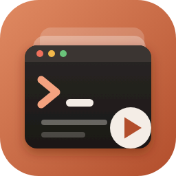

<p align="center">
  
</p>

<h1 align="center">Claude Terminal Sessions</h1>

<p align="center">
  Every Claude Code session you have run in the terminal, from every project folder, in one VS Code sidebar.<br>
  See what each session was about, what it changed, and jump back in with one click.
</p>

---

## Why

When you use Claude Code across many repos, sessions pile up in different folders and it is hard to remember
*which* session handled *which* task. `claude --resume` only lists sessions for the current folder.

**Claude Terminal Sessions** reads the session history Claude Code already keeps on your machine
(`~/.claude/projects`) and shows all of it, across all folders, grouped by day.

## Features

### All sessions, everywhere
- Sessions from **every folder**, newest first
- Grouped by **Today / Yesterday / Earlier this week / Earlier this month / Older**, or by **folder** (toggle in the toolbar)
- Each row shows the **session name**, **folder**, and **when it was last used**
- **Name** is taken from your `/rename` title, then Claude's automatic title, then your first prompt
- Hover for details: description (first and last prompt), full folder path, git branch, start and last-active dates, prompt count, session ID

### Expand a session to see its context
```
▾ dark-mode-toggle                        my-web-app · 2h ago
  ▶ Resume session                        claude --resume 7c3e9a12…
  📖 Open conversation                    readable transcript
  📁 Folder                               ~/projects/my-web-app
  🌿 Branch                               feature/dark-mode
  🔑 Session ID                           7c3e9a12-4f8b-4d21-…
  ▾ 💬 Prompts                            4
      👤 Add a dark mode toggle to the…   Nov 5, 10:12 AM
      👤 Remember the choice in local…    Nov 5, 10:31 AM
      👤 Write tests for the toggle       Nov 5, 10:48 AM
      👤 Fix the failing snapshot test    Nov 5, 11:02 AM
  ▾ 📄 Files changed                      3
      ThemeToggle.tsx                     src/components · 3× Edit
      theme.css                           src/styles · 2× Edit
      ThemeToggle.test.tsx                src/components · 1× Write
  ▸ 💻 Commands run                       6
      Run the theme tests                 npm test -- ThemeToggle
      Start the dev server                npm run dev
```

| Item | Click | Right-click |
|---|---|---|
| **Resume session** | Opens a terminal in the session's folder and runs `claude --resume <id>` | |
| **Open conversation** | Opens a readable Markdown copy of the session: prompts, Claude's replies, every tool step | |
| **Folder** | Opens the folder in a new VS Code window | |
| **Session ID** | Copies the ID | |
| **Prompt** | Opens the conversation at that prompt | |
| **Changed file** | Opens the file | |
| **Command run** | Shows it in the conversation | Copy, or paste into a terminal (not run until you press Enter) |

### Toolbar
- 🔍 **Filter** by title, prompt text, folder, branch or session ID
- 🌲 **Group by** date or folder
- 🔄 **Refresh** (the list also refreshes when sessions change)

### Session right-click menu
Resume in terminal · Open conversation · Copy session ID · Copy resume command
(`cd '<folder>' && claude --resume <id>`) · Open folder in new window · Open raw transcript (`.jsonl`)

## Requirements

- VS Code 1.90 or newer
- [Claude Code](https://docs.claude.com/en/docs/claude-code) installed and on your `PATH` (needed to resume sessions)

## Installation

**From a `.vsix` file**

```bash
code --install-extension claude-terminal-sessions-0.3.0.vsix
```

or in VS Code: **Extensions** panel → `···` menu → **Install from VSIX…**

Then click the **Claude Terminal Sessions** icon in the activity bar.

## Settings

| Setting | Default | Description |
|---|---|---|
| `claudeSessions.claudeCommand` | `claude` | Command used to launch Claude Code (e.g. a full path or an alias) |
| `claudeSessions.groupBy` | `date` | Group sessions by `date` or `folder` |
| `claudeSessions.maxSessions` | `300` | Maximum number of sessions to show |

## Privacy

Everything stays on your machine. The extension only **reads** the session files in `~/.claude/projects`.
It never changes them and never sends anything over the network. Each user sees only their own sessions.

## Building from source

```bash
git clone https://github.com/SwaroopGajula/claude-terminal-sessions.git
cd claude-terminal-sessions
npx @vscode/vsce package
code --install-extension claude-terminal-sessions-*.vsix
```

There is no build step: the extension is a single plain JavaScript file (`extension.js`) with no dependencies.

## Notes

This is an unofficial community tool and is not affiliated with or endorsed by Anthropic.
It relies on Claude Code's local session file format, which may change between Claude Code versions.

## License

[MIT](LICENSE)
