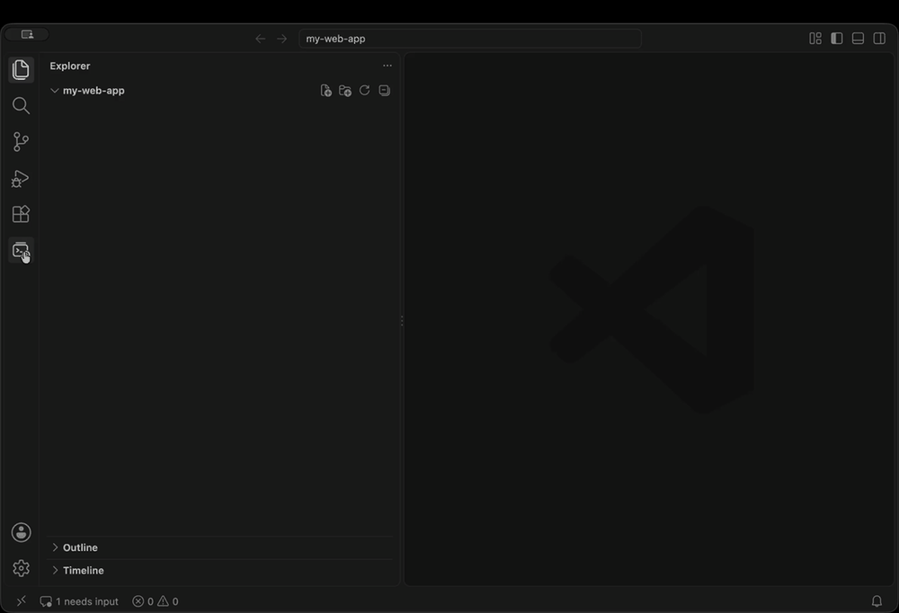

<p align="center">
  
</p>

<h1 align="center">Claude Terminal Sessions</h1>

<p align="center">
  Every Claude Code session you have run in the terminal, from every project folder, in one VS Code sidebar.<br>
  See what each session was about, what it changed, and jump back in with one click.
</p>

<p align="center">
  <a href="https://marketplace.visualstudio.com/items?itemName=SwaroopGajula.claude-terminal-sessions"></a>
  <a href="https://marketplace.visualstudio.com/items?itemName=SwaroopGajula.claude-terminal-sessions"></a>
  <a href="https://open-vsx.org/extension/SwaroopGajula/claude-terminal-sessions"></a>
  <a href="LICENSE"></a>
</p>

<p align="center"></p>

---

## Why

When you use Claude Code across many repos, sessions pile up in different folders and it is hard to remember
*which* session handled *which* task. `claude --resume` only lists sessions for the current folder.

**Claude Terminal Sessions** reads the session history Claude Code already keeps on your machine
(`~/.claude/projects`) and shows all of it, across all folders, grouped by day.

## Features

### All sessions, everywhere
- Sessions from **every folder**, newest first
- Grouped by **Today / Yesterday / Earlier this week / Earlier this month / Older**, or by **folder** (toggle in the toolbar)
- Each row shows the **session name**, **folder**, and **when it was last used**
- **Name** is taken from your `/rename` title, then Claude's automatic title, then your first prompt
- Hover for details: description (first and last prompt), full folder path, git branch, start and last-active dates, prompt count, session ID

### Search inside conversations
Click **Search Inside Conversations** (the fuzzy-search icon) in the toolbar and type what you are looking for, for example
`ThemeToggle.tsx`, `npm test` or `migration`. It searches every session's prompts, Claude's replies, the commands Claude ran
and the files it changed. All words must appear on the same line, in any order; case does not matter.

```
"ThemeToggle": 7 matches in 2 sessions
  ⊟ Show the 2 matching sessions in the sidebar
  ── dark-mode-toggle · my-web-app ─────────────────
  ✏️ **Write** `~/projects/my-web-app/src/ThemeToggle.tsx`     File changed
  ✨ I will add a ThemeToggle component and store the…          Claude
  💻 `npm test -- ThemeToggle` — Run the toggle tests          Command
  ── settings-page-redesign · my-web-app ───────────
  👤 Move the ThemeToggle into the new settings panel          Your prompt
```

- Pick a match to open that conversation **at that exact line**
- Or pick **Show the matching sessions in the sidebar** to filter the list to them. Click **Clear Filter** to go back.
- Handy for questions like *"which session touched `ThemeToggle.tsx`?"* or *"where did I run that migration?"*

The 🔍 **Filter** button is the quick version: it only looks at titles, prompts, folders, branches, session IDs, notes and labels.

### Token usage and cost
See how many tokens each session used and roughly what that would cost at Anthropic API list prices:

- **On each row:** the estimated cost, e.g. `my-web-app · 2h ago · $4.20`
- **On hover:** cost, output tokens, input tokens, cache reads and the models used
- **Inside an expanded session:** a **Token usage** section with the totals and a line per model
- **Daily summary:** the estimated cost per session and for the whole period
- **Token Usage and Cost Report** (📈 in the toolbar): pick *Today*, *Yesterday*, *This week*, *Last 7 / 30 days* or *All time*
  for a report by day, model, project and the most expensive sessions:

```markdown
# Claude Code usage: Last 7 days (2026-11-04 to 2026-11-10)

**≈ $86.40** · 720K output · 3.1M input · 210M cache reads · 1,120 requests

| Day        | Cost   | Output | Requests |
|------------|-------:|-------:|---------:|
| 2026-11-10 | $12.30 | 95K    | 160      |
| 2026-11-09 | $31.75 | 260K   | 410      |
```

How it is calculated:
- Prices are per model (Fable, Opus, Sonnet and Haiku generations), including **cache reads and writes**, which are usually most of
  the tokens in a Claude Code session. Fast mode counts at 2× and subagent (Task tool) transcripts are included.
- Claude Code writes each reply into the transcript several times; every reply is counted **once**.
- It is an **estimate at API list prices**. On a Pro or Max plan you pay the subscription instead, so read it as what the same work
  would cost through the API. Hide the cost with `claudeSessions.showCost: false` (token counts stay).
- Prices can change. Override or add a model with `claudeSessions.modelPricing` (US$ per million tokens), e.g.
  `{"claude-opus-5-5": {"input": 4, "output": 20, "cacheRead": 0.2, "cacheWrite5m": 5, "cacheWrite1h": 8}}`.
  Models without a known price show their tokens and are marked as not priced.

### Pin, notes and labels
Right-click a session (or click the rows inside an expanded session):

- **Pin to Top**: the session also appears in a 📌 **Pinned** group at the top of the list. **Unpin** removes it.
- **Edit Note…**: a line of your own, e.g. *step 2 of 4 done, next: tests*. It shows on the row (📝) and on hover. Clear the text to remove it.
- **Set Labels…**: tags like `#bug`, `#feature` or `#research`. Check existing labels, or type a new one and press **Enter**.
  Labels show on the row.

```
▾ 📌 Pinned                     1
    📌 dark-mode-toggle          #feature · my-web-app · 2h ago · 📝 step 2 of 4 done
▾ 📅 Today                      3
    💬 fix-login-redirect        #bug · api-server · 20m ago
```

To see one label only: **⋯** menu in the toolbar → **Filter by Label…**, or type `#bug` in the 🔍 filter
(you can combine it with words, e.g. `#bug login`).

Select several sessions (**Cmd/Ctrl+click** or **Shift+click**) to pin, label, archive or delete them together.

### Archive or delete finished sessions
- **Archive (hide from list)**: hides the session so the list only shows active work. Nothing is deleted, and an **Undo** button appears.
  If you resume an archived session it comes back automatically.
- **⋯** menu → **Show Archived Sessions**: shows an **Archived** group at the bottom, where you can **Unarchive**.
  Filters and searches always include archived sessions.
- **Auto-archive**: set `claudeSessions.autoArchiveDays` (e.g. `30`) to hide sessions you have not used for that many days.
  Pinned sessions and sessions with a follow-up are never auto-archived.
- **Delete Session (move to Trash)…**: removes the session for good. After a confirmation, the conversation file and its
  side files (subagent transcripts, file backups used by `/rewind`) go to the **Trash**, so you can still restore them from there.
  A session that is open in a terminal cannot be deleted until you exit Claude there.

Pins, notes, labels and archive state are stored by the extension (in VS Code's storage), not in Claude Code's files.

### See which sessions are running
A **Running** group at the top shows every Claude Code session that is open right now, in any terminal, live:

```
▾ 〰 Running                    1 needs input · 1 working · 3 open
    🔔 fix-login-bug             Needs input: input needed · api-server
    🔄 dark-mode-toggle          Working · my-web-app
    🟢 update-docs               Open · docs-site
```

- 🔄 **Working**: Claude is busy · 🔔 **Needs input**: waiting for you (e.g. a permission question) · 🟢 **Open**: idle
- The status bar shows how many sessions need your input; click it to jump to them
- Resuming a session that is already open warns you, and offers to **show its terminal** (if it runs in VS Code) or **fork** it instead

### Fork a session
Right-click → **Fork Session** (or *Fork session* inside an expanded session) starts a new copy of the conversation with the full
context (`claude --resume <id> --fork-session`). The original is left untouched, which is handy for trying a different approach.

### Follow-up reminders
For tasks you need to check on again in a few days (waiting for a deploy, a review, a data refresh…):

1. Right-click a session → **Set Follow-up Reminder…** (or click **Set follow-up…** inside an expanded session)
2. Choose **Tomorrow**, **In 2 / 3 days**, **Next Monday**, **In 1 / 2 weeks**, **In N days…** or **On a date…** (YYYY-MM-DD)
3. Add an optional note, e.g. *check the deploy*, or press **Enter** / **Escape** to skip it
4. A confirmation shows the date, with a **Change** button if you picked the wrong one

Then:
- A **Follow-ups** group appears at the top, soonest first, with *due tomorrow*, *due today*, *overdue 2 days*
- On the due date you get a reminder with **Resume**, **Snooze 1 Day** and **Done**
- The status bar shows how many follow-ups are due; click it to see them
- A session that is also running keeps its running icon (🔄 / 🔔 / 🟢) but still shows *⏰ due …* on its row
- To change or remove one: right-click → **Set Follow-up Reminder…** (pick a new date or **Clear follow-up**) or **Clear Follow-up**

```
▾ 🔔 Follow-ups                 1 due · 2 total
    🔔 fix-login-bug             ⏰ due today · api-server
    🔕 update-docs               ⏰ due in 3 days · docs-site
```

Reminders appear while VS Code is open; if it was closed on the due date, you get the reminder the next time you open it.
Follow-ups are stored by the extension (in VS Code's storage), not in Claude Code's files.

### Daily summary
Click **Daily Summary** (📅) in the toolbar and pick **Today**, **Yesterday**, **Last working day**, **This week**, **Last 7 days**
or a date. You get a Markdown report, ready for a standup or timesheet, of only the work done in that period:

```markdown
# Claude Code summary: Yesterday, Thursday, November 5, 2026

_2 sessions · 6 prompts · 4 files changed · 2 commits_

## my-web-app
### dark-mode-toggle
Branch `feature/dark-mode` · 10:12 AM – 11:40 AM · 4 prompts

**Asked:**
- Add a dark mode toggle to the settings page
- Write tests for the toggle
**Commits (pushed):**
- `feat: add dark mode toggle`
- `test: cover theme toggle`
**Files changed (3):** `src/components/ThemeToggle.tsx`, `src/styles/theme.css`, `src/components/ThemeToggle.test.tsx`
```

Commits and pull requests are detected from the git and `gh` commands Claude ran; failed commands are left out.
Copy it to the clipboard or open the preview from the notification.

### Expand a session to see its context
```
▾ dark-mode-toggle                        my-web-app · 2h ago
  ▶ Resume session                        claude --resume 7c3e9a12…
  ⑂ Fork session                          new branch of this conversation
  📖 Open conversation                    readable transcript
  🔔 Set follow-up…                       remind me later
  📝 Note                                 step 2 of 4 done, next: tests
  🏷 Labels                               #feature
  📁 Folder                               ~/projects/my-web-app
  🌿 Branch                               feature/dark-mode
  🔑 Session ID                           7c3e9a12-4f8b-4d21-…
  ▾ 💬 Prompts                            4
      👤 Add a dark mode toggle to the…   Nov 5, 10:12 AM
      👤 Remember the choice in local…    Nov 5, 10:31 AM
      👤 Write tests for the toggle       Nov 5, 10:48 AM
      👤 Fix the failing snapshot test    Nov 5, 11:02 AM
  ▾ 📄 Files changed                      3
      ThemeToggle.tsx                     src/components · 3× Edit
      theme.css                           src/styles · 2× Edit
      ThemeToggle.test.tsx                src/components · 1× Write
  ▸ 💻 Commands run                       6
      Run the theme tests                 npm test -- ThemeToggle
      Start the dev server                npm run dev
```

| Item | Click | Right-click |
|---|---|---|
| **Resume session** | Opens a terminal in the session's folder and runs `claude --resume <id>` | |
| **Fork session** | Same, with `--fork-session`: a new copy of the conversation | |
| **Set follow-up…** | Sets or changes a reminder for this session | |
| **Note** / **Add note…** | Edits your note for this session | |
| **Labels** / **Add labels…** | Edits the session's labels | |
| **Open conversation** | Opens a readable Markdown copy of the session: prompts, Claude's replies, every tool step | |
| **Folder** | Opens the folder in a new VS Code window | |
| **Session ID** | Copies the ID | |
| **Prompt** | Opens the conversation at that prompt | |
| **Changed file** | Opens the file | |
| **Command run** | Shows it in the conversation | Copy, or paste into a terminal (not run until you press Enter) |

### Share a session with someone else
Right-click a session → **Share**:

| Option | What the other person gets | Needs Claude Code? |
|---|---|---|
| **Export for Reading (.md)** | A readable Markdown file: prompts, Claude's replies, files changed and commands run (no command output) | No |
| **Export to Continue on Another Computer** | A `.claude-session.json` file they can import and **resume with full context** | Yes |

#### Export (the person sharing)
1. Open the **Claude Terminal Sessions** sidebar and find the session.
2. Right-click it and choose **Share: Export for Reading (.md)** or **Share: Export to Continue on Another Computer**.
3. Read the warning. It shows how many likely secrets were removed automatically. Click **Save…**.
4. Choose where to save the file (defaults to your `Downloads` folder).
5. Click **Open** to check the file, then send it (Slack, email, shared drive…).

#### Import (the person receiving)
*A `.md` export needs no import: just open it in any editor or Markdown viewer.*

For a `.claude-session.json` export:
1. Install **Claude Terminal Sessions** and [Claude Code](https://docs.claude.com/en/docs/claude-code).
2. Get the same project on your computer (clone the repo). Ideally check out the branch the session was on.
3. Open the **Claude Terminal Sessions** sidebar and click **Import Shared Session** (📥) in the toolbar.
4. Pick the `.claude-session.json` file.
5. Choose your local copy of the project. Folders with the same name are suggested first, or use **Browse…**.
6. If the session already exists on your computer, choose **Import as a copy** (it gets a new session ID).
7. Click **Resume now**. Claude Code opens in that folder with the full conversation, ready to continue.
   The session also appears in the sidebar, so you can resume it later.

**Before you share:** session files can contain anything that went through the session, including command output,
file contents, environment variables and internal URLs. The extension:
- removes likely secrets automatically (GitHub, GitLab, npm, Slack and Stripe tokens, AWS and Google keys, Anthropic and OpenAI keys, JWTs, private keys, passwords in URLs, and values of settings like `DB_PASSWORD` or `API_KEY`) and tells you how many it found
- leaves out Claude Code's internal request logs
- warns you before every export

Automatic detection is not perfect. **Read the file before sharing it**, and only share with people who may see that code and data.

### Toolbar
- 📅 **Daily Summary** of your Claude Code work
- 🔍 **Filter** by title, prompt text, folder, branch, session ID, note or `#label`
- 🔎 **Search Inside Conversations**: prompts, replies, commands and changed files
- 📈 **Token Usage and Cost Report** by day, model, project and session
- 🌲 **Group by** date or folder
- 📥 **Import Shared Session** from a `.claude-session.json` file
- 🔄 **Refresh** (the list also refreshes when sessions change)
- **⋯** menu: **Filter by Label…** · **Show / Hide Archived Sessions**

### Session right-click menu
Resume in terminal · Fork session · Open conversation · Copy session ID · Copy resume command
(`cd '<folder>' && claude --resume <id>`) · Open folder in new window · Open raw transcript (`.jsonl`) · Share: Export for Reading · Share: Export to Continue on Another Computer · Set Follow-up Reminder · Clear Follow-up · Pin to Top / Unpin · Edit Note · Set Labels · Archive / Unarchive · Delete Session (move to Trash)

## Requirements

- VS Code 1.90 or newer
- [Claude Code](https://docs.claude.com/en/docs/claude-code) installed and on your `PATH` (needed to resume sessions)

## Installation

**From the VS Code Marketplace (recommended)**

- [Install from the Marketplace](https://marketplace.visualstudio.com/items?itemName=SwaroopGajula.claude-terminal-sessions), or
- in VS Code open the **Extensions** panel and search **Claude Terminal Sessions**, or
- run:

  ```bash
  code --install-extension SwaroopGajula.claude-terminal-sessions
  ```

**Cursor, Windsurf, VSCodium and other VS Code-based editors**

Search **Claude Terminal Sessions** in the Extensions panel (it comes from [Open VSX](https://open-vsx.org/extension/SwaroopGajula/claude-terminal-sessions)).

**From a `.vsix` file**

```bash
code --install-extension claude-terminal-sessions-0.7.0.vsix
```

or in VS Code: **Extensions** panel → `···` menu → **Install from VSIX…**

Then click the **Claude Terminal Sessions** icon in the activity bar.

If you set `CLAUDE_CONFIG_DIR` to keep Claude Code's data somewhere other than `~/.claude`, the extension uses that folder too.
Start VS Code from a terminal where the variable is set (e.g. `code .`), so the extension can see it.

## Settings

| Setting | Default | Description |
|---|---|---|
| `claudeSessions.claudeCommand` | `claude` | Command used to launch Claude Code (e.g. a full path or an alias) |
| `claudeSessions.groupBy` | `date` | Group sessions by `date` or `folder` |
| `claudeSessions.maxSessions` | `300` | Maximum number of sessions to show |
| `claudeSessions.showCost` | `true` | Show the estimated cost (API list prices) on rows, in details and in the daily summary |
| `claudeSessions.modelPricing` | `{}` | Override or add model prices in US$ per million tokens |
| `claudeSessions.autoArchiveDays` | `0` | Hide sessions not used for this many days (`0` = off). Pinned and followed-up sessions are kept |

## Privacy

Everything stays on your machine. The extension **reads** the session files in `~/.claude/projects` and never
changes their contents or sends anything over the network. Each user sees only their own sessions.
Exports are only written where you choose to save them, and importing only adds a new session file under `~/.claude/projects`.
**Delete Session** is the only action that removes Claude Code files, always after a confirmation, and it moves them to the Trash.

## Development

```bash
git clone https://github.com/SwaroopGajula/claude-terminal-sessions.git
cd claude-terminal-sessions
npm run lint      # syntax check
npm test          # unit tests (secret removal, import, reminders, summary, labels, search)
npm run package   # builds claude-terminal-sessions-<version>.vsix
code --install-extension claude-terminal-sessions-*.vsix
```

There is no build step and there are no runtime dependencies. `extension.js` is the UI; the logic lives in plain JavaScript modules that are tested without VS Code: `share.js` (export/import), `running.js`, `followups.js`, `summary.js`, `marks.js` (pins, notes, labels, archive), `search.js` and `usage.js` (tokens and cost).

### Demo data for screenshots
`node scripts/demo.js` creates invented sessions in `~/claude-demo` and opens a separate VS Code window that shows only them,
so you can record screenshots or GIFs without exposing real work. Your normal VS Code and `~/.claude` are not touched.
`node scripts/demo.js --clean` removes everything again.

### Automatic builds and releases (GitHub Actions)
- **CI** (`.github/workflows/ci.yml`): every push to `main` and every pull request runs the checks and tests and builds the `.vsix`.
  Download it from the run page under **Artifacts**.
- **Release** (`.github/workflows/release.yml`): runs when a version tag is pushed.

To release a new version:
1. Bump `"version"` in `package.json` (e.g. `0.4.1`) and add a `## 0.4.1` section to `CHANGELOG.md`.
2. Commit, then tag and push:
   ```bash
   git tag v0.4.1
   git push && git push --tags
   ```
3. The workflow tests and builds, creates a GitHub Release with the `.vsix` and the changelog notes, and publishes to the
   VS Code Marketplace and Open VSX using **Trusted Publishing**, so no tokens are stored. It is set up once for this repo and
   `release.yml`, under the Marketplace publisher's *Trusted Publishing* tab and at
   [open-vsx.org/user-settings/trusted-publishers](https://open-vsx.org/user-settings/trusted-publishers).

## Like it?

If this saves you time, please ⭐ [star the repo](https://github.com/SwaroopGajula/claude-terminal-sessions) and
[rate it on the Marketplace](https://marketplace.visualstudio.com/items?itemName=SwaroopGajula.claude-terminal-sessions&ssr=false#review-details).
It helps other Claude Code users find it. Ideas and bug reports are welcome in [Issues](https://github.com/SwaroopGajula/claude-terminal-sessions/issues).

## Notes

This is an unofficial community tool and is not affiliated with or endorsed by Anthropic.
It relies on Claude Code's local session file format, which may change between Claude Code versions.

## License

[MIT](LICENSE)
